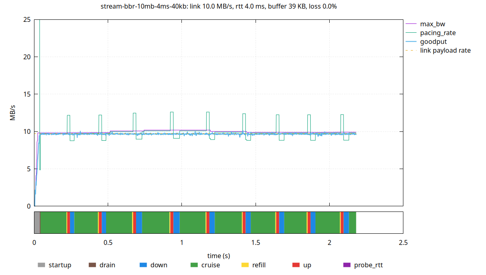

# udx-lab

Linux-specific UDX experiments that require platform support that libuv doesn't
yet offer.

## Building and testing

Linux only. 

```
make test     # builds and run tests in test/, with asan.
make qdxperf  # an optimized throughput tool, build/qdxperf
```


## Protocol changes

- each packet gets a new number, eliminating transmission ambiguity
- data packets carry the 64bit offset of their data
  - allows re-packetization of inflight data
  - receiver enforces the receive window
- receive window sets a new max_offset that increases monotonically

todo:
- 16-bit relative sack
- ack-delay field


## Portable implementation changes

- per-socket and per-stream memory pools
- bbr v3 (WIP). doesn't (yet) implement undo or extra_acked (ack aggregation
  compensation)

## Linux-specific details

- stand-alone event loop.
- microsecond timer resolution
- connect-over-unconnected, so each ip:port:ip:port tuple gets its own buffer
  - also saves a route lookup on transmit, and decouples the stream lifetime
    from the originating unconnected socket

todo:
- GSO
- offload pacer to kernel with SO_TXTIME
- kernel timestamping
- ICMP error handling - ECN, ECONNREFUSED, EMTU, ...
- SO_RXQ_OVFL



